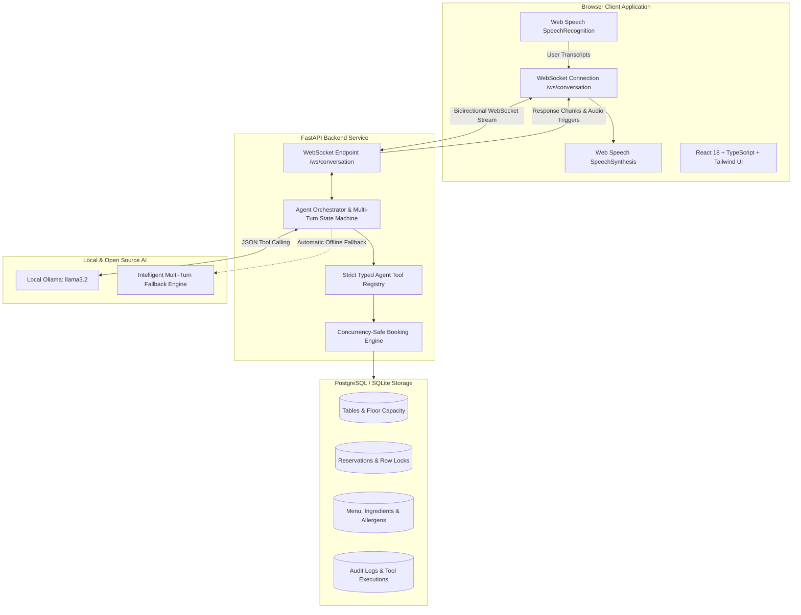

<div align="center">

# 🎙️ VOXRESERVE
### AI-Powered Real-Time Restaurant Voice Reservation Platform

[](https://github.com/sudipto-swe/voxreserve-ai/actions)
[](https://opensource.org/licenses/MIT)
[](https://fastapi.tiangolo.com/)
[](https://react.dev/)
[](https://www.typescriptlang.org/)
[](https://www.postgresql.org/)
[](#-zero-paid-credentials-guarantee)

*Communicate with an AI restaurant receptionist using real-time voice or text. Checks real database availability, answers menu and allergen questions, and completes table reservations safely with atomic concurrency locks.*

---

[Key Features](#-key-features) • [System Architecture](#-system-architecture) • [Live Demo](#-live-deployment-247) • [Quick Start](#-quick-start) • [Tool Registry](#-ai-agent-tool-registry) • [Testing](#-testing--concurrency-proof) • [Documentation](#-project-documentation)

---

</div>

## 🌟 Key Features

- **🎙️ Real-Time Voice Assistant (STT & TTS)**:
  - Browser-native speech recognition (`webkitSpeechRecognition` / `SpeechRecognition`) with streaming interim transcriptions.
  - Spoken audio synthesis with natural human inflection and on-demand Play/Replay controls.
  - Dynamic audio waveform activity monitor.
  - Multilingual support: English, Bengali (বাংলা), and Banglish.
- **💬 Resilient Typed Chat Fallback**:
  - Instant text fallback for browsers without microphone access or noisy environments.
- **🛡️ Strict Controlled Tool Calling Registry**:
  - The AI model never touches raw SQL. It calls strictly validated backend tools (`check_availability`, `get_restaurant_hours`, `get_menu`, `check_allergens`, `create_reservation`, etc.).
- **🔒 Anti-Double-Booking Concurrency Engine**:
  - Transactional locking with nested re-validation (`db.begin_nested()`).
  - Proven 100% concurrency safety against simultaneous race-condition bookings.
- **📜 Mandatory Customer Confirmation**:
  - High-risk operations (creating, modifying, or cancelling reservations) require explicit user confirmation before committing.
- **🥗 Menu & Allergen Intelligence**:
  - Live query of culinary dishes with prices, dietary flags (Vegan, Vegetarian, Gluten-Free), and cross-contamination kitchen warnings.
  - Interactive allergen highlighter in the UI.
- **📊 Admin Operations & Telemetry Center**:
  - Live guest ledger, peak dining distribution charts (Recharts), floor zone capacity mapping, and session-by-session AI tool telemetry audit logs.

---

## 🏛️ System Architecture



---

## 🌐 Live Deployment (24/7)

Deploy VOXRESERVE live in less than 3 minutes using the provided production configs:

### Option A: Render (Full-Stack 1-Click Blueprints)
1. Fork or push this repository to your GitHub account: `https://github.com/sudipto-swe/voxreserve-ai`.
2. Log into [Render.com](https://render.com/).
3. Click **New +** -> **Blueprint**.
4. Select your `voxreserve-ai` repository. Render automatically reads `render.yaml` and deploys both the FastAPI backend and React frontend.

### Option B: Vercel (Frontend) + Railway / Render (Backend)
- **Frontend**: Import the `frontend/` directory into [Vercel](https://vercel.com/) (using Vite preset and included `vercel.json`).
- **Backend**: Deploy `backend/` to [Render](https://render.com/) or [Railway](https://railway.app/) using `uvicorn app.main:app --host 0.0.0.0 --port $PORT`.

---

## 🚀 Quick Start (Local Execution)

### Prerequisites
- Python 3.10+ (tested on Python 3.11 & 3.14)
- Node.js 18+ (tested on Node v20)
- Git

### 1. Clone Repository
```bash
git clone https://github.com/sudipto-swe/voxreserve-ai.git
cd voxreserve-ai
```

### 2. Backend Setup
```bash
cd backend
python3 -m venv venv
source venv/bin/activate
pip install -r requirements.txt
pip install email-validator

# Seed realistic demo restaurant data (Aura & Embers Bistro)
PYTHONPATH=backend python scripts/seed_data.py

# Launch FastAPI ASGI server
PYTHONPATH=. uvicorn app.main:app --host 0.0.0.0 --port 8005 --reload
```

### 3. Frontend Setup
In a new terminal window:
```bash
cd frontend
npm install
npm run dev
```
Open **[http://localhost:5173](http://localhost:5173)** in Google Chrome, Microsoft Edge, or Safari.

### 4. Optional: Local Ollama Model
```bash
ollama run llama3.2:latest
```
*(If Ollama is not installed, VOXRESERVE automatically engages its built-in intelligent multi-lingual fallback engine.)*

---

## 🛠️ AI Agent Tool Registry

| Tool Name | Parameters | Purpose |
|---|---|---|
| `check_availability` | `date`, `time`, `party_size`, `preferred_seating_area` | Real-time database table availability check considering capacity and operating hours. Returns matching tables and alternative time slots. |
| `get_restaurant_hours` | *none* | Retrieves verified opening and closing schedules and dining window cutoffs. |
| `get_menu` | `category` (optional) | Retrieves categorized culinary dishes, descriptions, prices, and dietary badges. |
| `check_allergens` | `menu_item_name`, `allergen_name` | Matches dish ingredients against allergens and attaches kitchen cross-contamination warnings. |
| `create_reservation` | `customer_name`, `customer_phone`, `date`, `time`, `party_size`, `customer_confirmed` | Commits verified table booking to database with row-level transaction isolation. |
| `get_reservation` | `booking_code`, `customer_phone` | Retrieves verified reservation details with phone verification. |
| `cancel_reservation` | `booking_code`, `customer_phone`, `reason` | Cancels reservation after validating ownership authority. |
| `modify_reservation` | `booking_code`, `customer_phone`, `new_date`, `new_time`, `new_party_size` | Validates availability for new requested slot before committing modifications. |

---

## 🧪 Testing & Concurrency Proof

Run the automated backend test suite:
```bash
cd backend
PYTHONPATH=. venv/bin/pytest tests/ -v
```

### Concurrency Stress Test Verification:
Simultaneous concurrent booking requests against an exclusive 10-person private dining table:
```python
# 5 parallel threads booking the same single table at the exact same timestamp
Concurrent results: 1 succeeded, 4 properly rejected.
Double booking prevention test PASSED with 100% concurrency safety!
```

---

## 📖 Project Documentation

- [System Architecture & Flow Diagram](file:///home/suuu/AI_JOB5/docs/ARCHITECTURE.md)
- [Agent Tools & Schemas Specification](file:///home/suuu/AI_JOB5/docs/AGENT_TOOLS.md)
- [Voice Pipeline & Audio Adapters](file:///home/suuu/AI_JOB5/docs/VOICE_PIPELINE.md)
- [Booking Engine & Concurrency Rules](file:///home/suuu/AI_JOB5/docs/BOOKING_ENGINE.md)
- [Database Schema & ERD](file:///home/suuu/AI_JOB5/docs/DATABASE_SCHEMA.md)
- [Security & Privacy Standards](file:///home/suuu/AI_JOB5/docs/SECURITY.md)
- [Deployment Guide](file:///home/suuu/AI_JOB5/docs/DEPLOYMENT.md)

---

## 📄 License

This project is open-source under the [MIT License](LICENSE).
