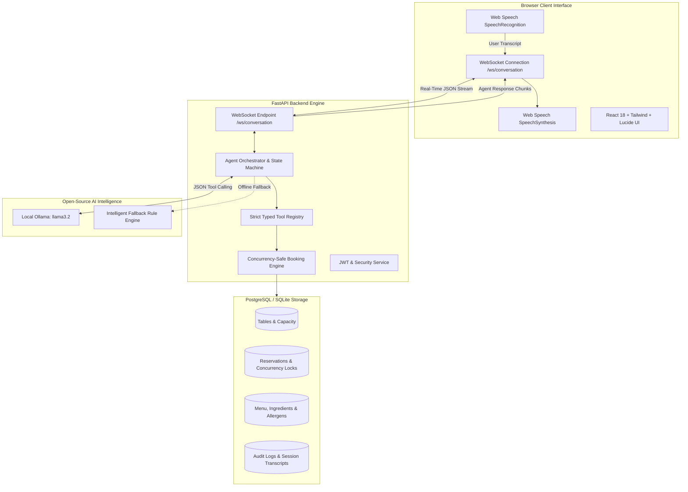

# ARCHITECTURE — VOXRESERVE

VOXRESERVE is a real-time, AI-driven restaurant voice and text reservation platform designed to operate with zero paid API dependencies.

## Core Components

1. **Client Browser**: Leverages browser-native Web Speech API for low-latency Speech-to-Text and Speech-to-Text without external billing or third-party tracking. Provides typed chat fallback if speech is denied or unsupported.
2. **WebSocket Conversation Protocol**: Transmits user transcripts, thinking indicators, database tool executions, and audio synthesis triggers in real time.
3. **Agent Tool Registry**: Strict validation preventing the LLM from executing raw queries or fabricating availability.
4. **Booking & Concurrency Engine**: Performs transactional re-validation inside nested transactions to ensure zero double-booking even under concurrent load.
